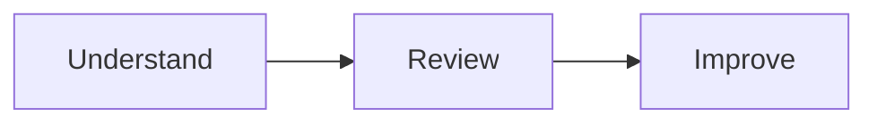

# `/sdr`: System Design Review Skill

## What it does

Acts as a software architect reviewing a team's high-level design before they present or build it. Given a problem statement and a design (Mermaid or image), it answers four questions:

1. Does the design solve the problem?
2. What should change?
3. Which failures were missed?
4. Is there a simpler design that meets the same requirements?

It ends with a verdict: `agree | agree with changes | rework`.

## How it's built

One workflow file plus two reference files:

| File | Role |
|---|---|
| `SKILL.md` | The three-phase workflow and the rules |
| `lenses.md` | Checklist every design is reviewed against |
| `estimation.md` | Back-of-envelope numbers so findings rest on math, not opinion |

### The workflow

- **Understand:** restate the requirements with numbers (including the availability target) and the design. Ask only questions that would change the review.
- **Review:** run the design through the lenses and estimates, and produce the four answers plus the verdict.
- **Improve:** the team accepts or rejects each item. The skill then proposes handling for the failures they chose and returns a final design with what changed, the accepted downtime and what was set aside.

### The lenses

- **Requirements fit:** every requirement has a flow or mechanism that meets it.
- **Right-sizing:** what can be removed, and what exists for scale the numbers never reach.
- **Failure handling:** whether the stated handling works and fits the downtime budget.
- **Missed failures:** single points of failure, slow dependencies, lost or duplicate writes, blast radius.
- **Consistency:** the source of truth for each piece of data, and whether eventual consistency is acceptable.
- **Operability:** safe deploy and rollback, and health visible before users notice.

### The estimates

QPS conversions, availability budgets (99.9% is about 43 min of downtime a month), storage and latency figures, and single-node limits. The key takeaway: **one relational database covers most problems below a few thousand writes per second.**

## Rules it follows

- **KISS:** start from one service and one database, and make every addition justify itself.
- Judge the design against this problem, not an ideal system.
- Tie every finding to a requirement, a number or a failure.
- Never name a technology without the requirement it serves.
- No praise. The team decides, and the skill records the decision.
