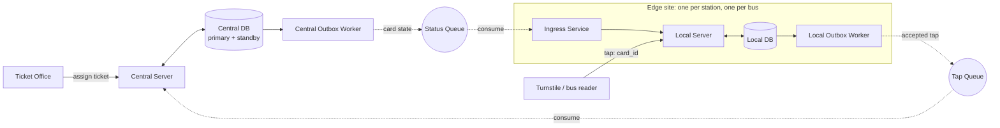
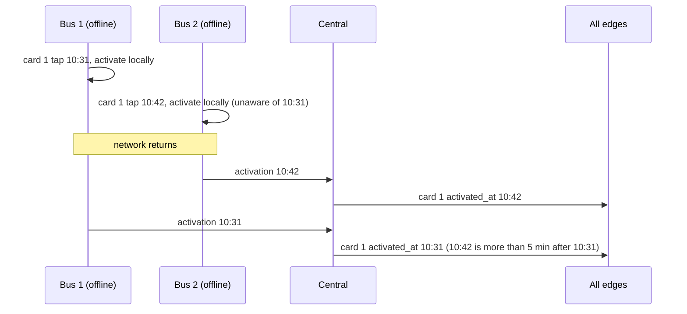

# Ticket Validation System: High-Level Design

## Problem

Design ticket assignment, validation and activation for a city's public transport: 50 subway stations, 30 bus routes, about 2 million trips a day.

- Purchase and payment already exist. Tickets are bought at stations and assigned to a travel card.
- Riders validate or activate a ticket by tapping the card at a turnstile or on a bus.
- Ticket types: single (valid `x` minutes from activation), day, week and month passes.
- The card stores no data; it only presents its id.
- A card holds one ticket at a time.

Out of scope: purchase, payment, refunds, card blocking, fare inspection.

## Requirements

**Functional**

- FR1 Assign a purchased ticket to a card at a station ticket office.
- FR2 Tapping a card activates its unactivated ticket, or validates its active ticket.
- FR3 Support single, day, week and month tickets. Every type is valid for a rolling duration from activation (`x` minutes, 24 hours, 7 days, 30 days), not by calendar period.
- FR4 A card holds at most one ticket (assigned or active) at a time. A rider buys the next ticket after the current one expires; tickets are not queued.
- FR5 A ticket must be activated within 1 calendar year of assignment. After that it expires unused and the card is free for a new ticket.
- FR6 A card that was accepted less than `c` minutes ago, at any gate or bus, is rejected. `c` is short (default 2 minutes) and the same everywhere, so one card cannot carry two riders through at once.

**Non-functional**

- NFR1 Tap decision under 500 ms (p99), tap to open.
- NFR2 Buses keep validating and activating with no network for at least 1 hour.
- NFR3 Station gates keep working when the central system is down.
- NFR4 A newly bought ticket works at every gate and connected bus within 1 minute.
- NFR5 No activation is ever lost.

Ticket assignment needs the central system. If it is down, sales fail; this is accepted.

## Estimates

| Quantity | Value |
|---|---|
| Taps | 2M/day: 23/s average, ~110/s peak hour (20% of the day), ~300/s bursts |
| Assignments | under 23/s average (at most one per trip) |
| Card state | a few million rows x ~150 B, under 1 GB: every edge site holds a full copy |
| Entry points | ~300 gates, ~300 buses |
| Edge sites | 50 station servers + ~300 bus computers, ~350 consumers of the status stream |
| Status fan-out | ~4M events/day (taps plus assignments) x 350 sites, ~16k deliveries/s average, a few MB/s; per bus ~50 events/s, ~5 KB/s |

One relational database handles the central load many times over. Scale does not drive the design; offline operation (NFR2, NFR3), not losing activations (NFR5) and comparing tap times across devices (FR6, merge rule) do.

## Architecture

| Component | Role |
|---|---|
| Central Server + Central DB | Source of truth for tickets per card. Enforces FR4 and FR5 at assignment. Merges taps from all edges. |
| Central Outbox Worker | Publishes every committed card state change to the Status Queue. |
| Status Queue | Durable log, keyed by `card_id`, with a per-consumer offset. Fans card state out to every edge site. |
| Edge site | Station server (on the station LAN) or bus computer. Holds a full copy of card state and decides every tap locally. |
| Ingress Service | Consumes the Status Queue and merges card state into the Local DB. |
| Local Server | Answers taps from the Local DB. Records accepted taps, including activations. |
| Local Outbox Worker | Publishes accepted taps to the Tap Queue, draining the backlog after an outage. |
| Tap Queue | Durable queue from all edges to the Central Server. Carries activations and validations, since FR6 needs the last accepted tap at every edge. |
| Turnstile / bus reader | Thin device: reads `card_id`, asks the Local Server, opens or rejects. |

## Key decisions

1. **Every tap is decided at the edge, from a full local copy.** Meets NFR1 (LAN or on-board lookup), NFR2 and NFR3 (no central call on the tap path). Card state is small enough to copy everywhere. Trade-off: an edge can decide on stale data while disconnected (see Guarantees).
2. **Central owns assignment; the edge owns tap times.** Taps happen where the rider is, often offline, so the edge records them and central merges. Assignment needs the network; tapping never does.
3. **Conflicting activations: the latest tap within `y` of the earliest wins, `y` = 5 minutes.** If edges that have not yet synced each activate the same ticket, the effective activation is the latest one no more than 5 minutes after the earliest. A rider who taps twice in quick succession gets the later, longer window; later activations from a stale bus are ignored, so no conflict stretches a ticket by more than 5 minutes. The rule is a function of the whole set of activations, so arrival order does not change the result. Trade-off: central and edges keep the short list of activations per ticket instead of one timestamp.
4. **All accepted taps are synced, not only activations.** FR6 compares a tap with the card's last accepted tap anywhere, so every edge needs it. This roughly doubles the stream volume, which the estimates absorb.
5. **Clock sync is part of the design.** The merge rule and FR6 compare timestamps from different devices, so clocks must agree to within seconds. Buses take time from GPS, which works with no network and after the bus has been parked or switched off; a battery-backed clock covers boot until the first fix. Station servers sync over the station LAN. Each edge reports its clock offset to central when connected, and an offset over 5 seconds raises an alert.
6. **Transactional outbox on both sides.** Central writes card state and its outbox row in one transaction; the edge writes the accepted tap and its outbox row in one transaction before the gate opens. A crash cannot commit a change without its event (NFR5).
7. **Status Queue is a replayable log, not a work queue.** Each edge keeps its own offset and catches up after reconnecting. A site offline beyond retention, or a new bus, bootstraps from a central snapshot plus the log offset it was taken at.
8. **Full card state on the stream, not deltas.** Each message carries the card's current ticket, its activations and its last accepted tap, so applying it twice or out of order is safe under the merge rules below.
9. **Central DB: one primary with a standby for failover.** At 23 writes/s read replicas add nothing; the standby only shortens sales downtime.

## Data and keys

| Entity | Key | Fields |
|---|---|---|
| Card ticket (central and every edge) | `card_id` | `ticket_id`, `ticket_type`, `duration`, `assigned_at`, `activate_by`, `activations` (list of `event_id`, `tapped_at`), `last_tap_at`, `last_tap_edge` |
| Tap event | `event_id` (edge-generated, unique) | `card_id`, `ticket_id`, `kind` (activate or validate), `tapped_at`, `edge_id` |
| Status message | `card_id` | full card ticket row |

Derived, never stored independently:

- `activate_by = assigned_at + 1 calendar year`
- `activated_at = max(t in activations where t <= min(activations) + y)`, null when there are no activations
- `expires_at = activated_at + duration`

## Invariants

- I1 A card has at most one ticket that is either unactivated and before `activate_by`, or activated and before `expires_at`. Central rejects an assignment that would break this.
- I2 A ticket's set of activations only grows. Central and every edge merge by union on `event_id` and derive `activated_at` with the rule above, so every copy that holds the same set agrees.
- I3 `last_tap_at` merges by max, so it is order-independent too.
- I4 A newer `ticket_id` for a card replaces an older one only when the older one is expired or past `activate_by`, so edges merge by keeping the later-assigned ticket and, for the same ticket, applying I2 and I3.
- I5 An edge commits an accepted tap (row plus outbox entry) to durable local storage before the gate opens.
- I6 Central applies each `event_id` at most once.
- I7 Edge clocks stay within 5 seconds of true time.

## Flows

**Assignment (FR1, NFR4)**

1. Rider presents the card at the ticket office; purchase completes in the existing system.
2. Ticket Office sends `card_id` and the ticket to the Central Server.
3. Central checks I1, then writes the card ticket and an outbox row in one transaction.
4. The outbox worker publishes the card state; every connected edge applies it within seconds.

**Tap (FR2, FR5, FR6, NFR1)**

1. Reader sends `card_id` to the Local Server.
2. Local Server reads the card's ticket from the Local DB:
   - no ticket, expired, or unactivated past `activate_by`: reject.
   - `now - last_tap_at < c`: reject (cooldown).
   - active and not expired: record a validate tap, open.
   - assigned and not activated: record an activate tap, open.
   - Each recorded tap is committed with an outbox row (I5) and updates `last_tap_at`.
3. The Local Outbox Worker sends the tap event to the Tap Queue, now or when the network returns.
4. Central merges it (I2, I3, I6), writes the new state with an outbox row, and the Status Queue carries it to every edge.

**Offline reconciliation**

Had the second tap been at 10:34, the result would be 10:34. The order the events arrive in does not change the result.

## Guarantees

- **Activations are durable (NFR5):** an activation is on disk at the edge before the gate opens, and in the edge outbox until central acknowledges it.
- **Convergence:** once every edge has drained its outbox and caught up on the Status Queue, all copies of a card agree.
- **Freshness (NFR4):** a new ticket reaches every connected edge in seconds, well inside 1 minute. A disconnected bus sees it after reconnecting.
- **Bounded extension:** conflicting activations never stretch a ticket by more than `y` = 5 minutes.
- **Cooldown is enforced where it can be seen:** across connected edges within seconds of the first tap. An offline bus sees only its own taps.

## Accepted risks

- **Station server is a single point of failure for its station.** Gates and the station server share a physical LAN, and the server goes down only for routine maintenance. During maintenance that station's gates stay open: the rider always gets the benefit of the doubt and nobody is stranded. Taps during that window are neither checked nor recorded, so the revenue is lost.
- **Stale buses can accept an expired ticket.** While a bus is offline it cannot see taps made elsewhere, so a ticket that expired by its first activation on another device can still pass on that bus. The exposure is limited to the offline window and to revenue, never to wrongly rejecting a valid rider.
- **Short transfers inside the cooldown are rejected.** A rider who leaves one bus and taps another within `c` minutes waits out the cooldown.
- **Sales need central.** Ticket assignment fails while the central system is down.

## Failure modes

| Failure | Effect | Handling |
|---|---|---|
| Central Server or DB down | Sales fail; taps unaffected | Failover to standby; taps queue in edge outboxes |
| Status or Tap Queue down | Edges go stale; taps unaffected | Edges and central keep outbox backlogs and drain on recovery |
| Station server in maintenance | That station's gates cannot decide | Gates stay open for the whole window (accepted risk) |
| Bus loses network | Bus decides on its copy (NFR2) | Outbox drains and Status Queue replays on reconnect |
| Bus offline beyond log retention, or new bus | Offset no longer in the log | Bootstrap from central snapshot, then replay |
| Bus without GPS fix after boot | Time from battery-backed clock | Drift is seconds per day; offset reported and alerted (I7) |
| Edge crash mid-tap | Gate did not open, or the tap is on disk | I5: nothing is opened without a committed tap |
| Duplicate tap delivery | None | `event_id` dedupe (I6) and set union (I2) |
| Edge clock drift beyond 5 s | Wrong merge or cooldown decisions | Offset alert; GPS and LAN time sources (I7) |
